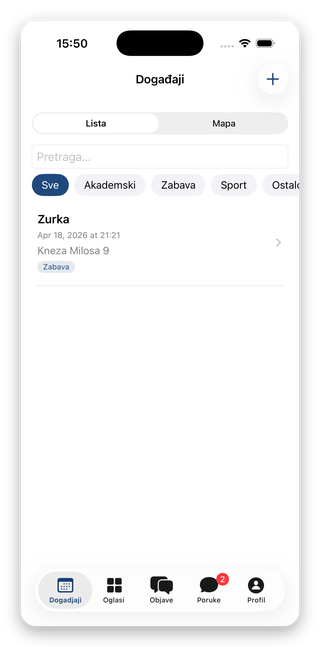
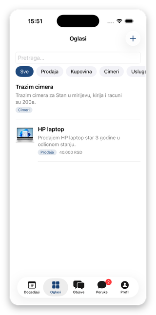
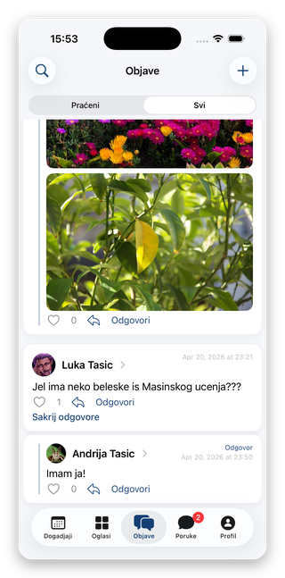
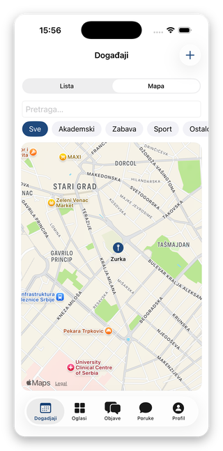
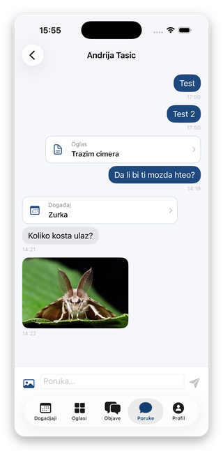
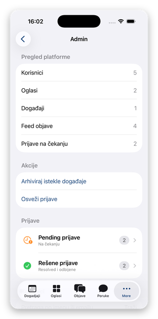
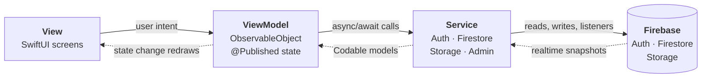

# UniConnect

A campus social network for students, built as a native iOS app: events with a
map, a classifieds board, a threaded feed, real-time messaging, user following,
profiles, and an admin moderation panel.

Written in SwiftUI following MVVM with a dedicated service layer, backed by
Firebase (Authentication, Cloud Firestore, Storage) and server-side security
rules. Originally my undergraduate thesis project.


> **Note on running this project.** The Firebase project that backed this app
> has been decommissioned, so a fresh clone will not connect to a live backend.
> The repository is published as a code sample. To run it end to end you need
> your own Firebase project — see [Getting started](#getting-started).
>
> The app's user-facing strings are in Serbian; it was built for a
> Serbian-speaking university. Code, comments, and this document are a mix of
> Serbian (in-code comments) and English.

## Screenshots

| Events | Marketplace | Feed |
|:---:|:---:|:---:|
|  |  |  |

| Event map (MapKit) | Real-time chat | Admin panel |
|:---:|:---:|:---:|
|  |  |  |

## At a glance

| | |
|---|---|
| Language and UI | Swift, SwiftUI (declarative, no UIKit view controllers) |
| Architecture | MVVM + an isolated service layer |
| Minimum target | iOS 17 |
| Backend | Firebase Auth, Cloud Firestore, Firebase Storage |
| Dependencies | `firebase-ios-sdk` 12.12.1 via Swift Package Manager |
| Maps | MapKit, address geocoding via `MKLocalSearch` |
| Size | 69 Swift files, ~10,100 lines; 171 lines of Firestore rules, 49 of Storage rules |

Code distribution: 36 view files, 11 models, 9 utilities, 7 view models,
4 services.

## Features

**Accounts.** Sign up, sign in, password reset, and mandatory email
verification — the app is gated until the address is confirmed. User documents
live in `users/{uid}`. Accounts can be banned permanently or until a date, which
routes the user to a dedicated screen.

**Events.** List and map views, category filters, search, RSVP, and
create/edit/delete for the organizer. Addresses are entered as free text and
geocoded to coordinates on save.

**Marketplace.** Classified ads with multiple images, search, category filters,
and a "contact seller" flow that opens a chat tied to that specific listing.

**Feed.** Root posts with threaded replies, likes, images, a *Following* / *All*
filter, and user search.

**Messaging.** Real-time one-to-one chat with text and images, an unread badge
on the tab, and in-app content sharing — an event, listing, or post arrives as a
card that links back to the original.

**Social graph.** Follow and unfollow, follower/following lists, and user search
by display name.

**Reporting and moderation.** Users can report listings, events, posts,
profiles, and individual messages. Reports land in `reports` with a
`pending` / `resolved` status.

**Admin panel.** Visible only to users with `role: "admin"`. Dashboard counts,
report queues, ban/unban, content deletion, event archiving, user management,
and an audit trail in `admin_logs`.

## Architecture



| Layer | Responsibility |
|---|---|
| **Models** | `Codable` + `Identifiable` structs describing document shape only. No behaviour, no knowledge of where data came from. |
| **Services** | The only layer aware that Firebase exists. Shared singletons: `AuthService`, `FirestoreService`, `StorageService`, `AdminService`. |
| **ViewModels** | `@MainActor ObservableObject` classes holding `@Published` state, plus `isLoading` / `errorMessage`. Translate user intent into service calls. |
| **Views** | Presentation and navigation only. Never touch Firebase directly. |
| **Utilities** | Caching, geocoding, image compression, validation, follow-mirror backfill. |

The service layer is the deliberate addition to textbook MVVM. Because views and
view models only ever call service methods such as `fetchEvents()`, swapping the
data source — for a REST API, say — would be confined to that one layer.

### App entry and gating

`UniConnectApp` configures Firebase and renders `ContentView`, which acts as a
gate on auth state:

```
not signed in              -> LoginView
signed in, email unverified -> EmailVerificationView
signed in, verified, banned -> BannedView
all clear                   -> MainTabView (5 tabs, + Admin when role == admin)
```

View models are instantiated once at `MainTabView` and passed down through the
environment, so every screen reads the same state.

## Data model

Cloud Firestore (document store), not Realtime Database.

| Resource | Path |
|---|---|
| Users | `users/{uid}` |
| Following / followers | `users/{uid}/following/{targetId}`, `users/{uid}/followers/{followerId}` |
| Events | `events/{eventId}` |
| Listings | `posts/{postId}` |
| Feed posts | `feed_posts/{postId}` |
| Chats and messages | `chats/{chatId}`, `chats/{chatId}/messages/{messageId}` |
| Reports | `reports/{reportId}` |
| Admin audit log | `admin_logs/{logId}` |
| Images (Storage) | `profile_images/{uid}.jpg`, `posts/…`, `feed_posts/…`, `chats/…` |

Collection names are centralised in `Constants` rather than repeated as string
literals.

## Implementation notes

The decisions below are the ones worth reviewing — each solves a concrete
problem rather than following a default.

**Atomic RSVP.** Joining an event could not read-modify-write the attendee
list: two users tapping at once would overwrite each other. Instead the attendee
array and its counter are changed in a single server-side update using
`FieldValue.arrayUnion` / `arrayRemove` alongside `FieldValue.increment`. No
read before write, and no lost updates.

**Denormalised counters.** `attendeesCount` and `likesCount` are stored next to
the document so a list can render a number without reading the whole array.
They are always mutated in the same atomic operation as the array itself, so the
two cannot drift apart.

**Real-time messaging.** Messages use `addSnapshotListener` on the `messages`
subcollection, so a message appears without any user action. Listeners are
returned as registration handles that the view model stores and tears down when
the screen goes away — otherwise they keep consuming reads. The rest of the app
deliberately fetches on demand, where live updates would cost reads for no gain.

**Optimistic likes.** The like state flips locally on tap and the write happens
in the background; a failed write rolls the post back and surfaces an error.
Waiting on a round trip made the feed feel sluggish.

**Geocoding cached on write.** Event locations are typed as plain addresses
because that is natural for the user. `MKLocalSearch` resolves them to
coordinates once, at creation, and the result is persisted on the event. Resolving
at render time would have made a map of many events visibly slow.

**Images out of the database.** Photos are downscaled and compressed before
upload, stored in Firebase Storage, and referenced from Firestore by URL only —
Firestore caps document size and is priced for small documents. Profile images
are keyed by uid, so each user has exactly one and Storage rules can restrict
writes to that path.

**Follow mirrors, with the tradeoff stated.** Follow records duplicate the
display name and avatar so that follower lists render without an extra read per
row. That is intentional denormalisation: reads vastly outnumber profile edits.
The cost is reconciliation when a profile changes — `FirestoreService` runs two
collection group queries (`following` by `targetUserId`, `followers` by
`followerUserId`), deduplicates the references, and patches them in batches of
500. Backfilling pre-existing data is handled separately, by a per-user
migration gated on `UserDefaults` (`FollowMirrorMigration`) and a one-off Node
script for the whole database.

**User search without a search service.** `searchUsers` first runs a Firestore
prefix range query on `displayName` (`start(at:)` to `end(at: query + "\u{f8ff}")`,
capped at 30). If that yields few hits, it falls back to fetching 120 users and
filtering client-side on name and department. It is a pragmatic compromise:
Firestore cannot do substring or fuzzy matching, and the alternative was
indexing into a dedicated search service.

**Aggregation over reads.** The admin dashboard uses Firestore count aggregation
queries, which return a number without reading the documents.

**Startup latency.** The events, marketplace, and feed tabs load concurrently in
a task group instead of sequentially. `AuthorProfileCache` memoises author names
and avatars, since the same author recurs across many posts and chats.

## Security model

Client code runs on a device the user controls, so it is not trusted. The
`firestore.rules` and `storage.rules` files are the actual boundary; checks in
the app exist for UX only.

Rules are built from helper functions — `emailVerified()`, `notBanned()`,
`isActiveUser()`, `isAdmin()`, `isOwner()` — composed per collection. In effect:
a user may only modify their own content, only an admin may delete someone
else's, and chat writes require that the sender is a participant.

One subtlety worth calling out: read access on `users/{userId}` splits `get`
from `list`. A banned user must still be able to read *their own* document, or
the app could not detect the ban and show `BannedView` — but they get no access
to anything else.

Passwords are never stored by the app; Firebase Authentication holds them as
hashes.

## Project structure

```
.
├── UniConnect/
│   ├── UniConnect.xcodeproj/
│   ├── UniConnectApp.swift              # @main, Firebase configuration
│   ├── ContentView.swift                # auth / verification / ban gate
│   ├── Models/                          # 11 Codable structs
│   ├── Services/                        # 4 Firebase-facing services
│   ├── ViewModels/                      # 7 ObservableObject classes
│   ├── Views/                           # 36 files
│   │   ├── Auth/  Events/  Board/  Feed/
│   │   ├── Chat/  Profile/  Admin/  Components/
│   │   └── MainTabView.swift
│   ├── Utilities/                       # 9 helpers
│   ├── Assets.xcassets/
│   └── GoogleService-Info.plist.example # copy to .plist and fill in
├── firestore.rules                      # 171 lines
├── firestore.indexes.json
├── storage.rules                        # 49 lines
├── firebase.json
├── scripts/                             # Node.js admin tooling
│   ├── create-admin.mjs
│   └── migrate-followers-mirror.mjs
└── docs/screenshots/
```

## Getting started

Requires Xcode 15 or newer and a Firebase project.

**1. Clone and open**

```bash
git clone https://github.com/tasic17/UniConnect.git
cd UniConnect
open UniConnect/UniConnect.xcodeproj
```

Swift Package Manager resolves the Firebase SDK automatically on first open.

**2. Create a Firebase project**

In the [Firebase console](https://console.firebase.google.com), create a project
and register an iOS app. Enable **Authentication** (Email/Password),
**Cloud Firestore**, and **Storage**.

**3. Add your configuration**

Download `GoogleService-Info.plist` for your iOS app and place it at
`UniConnect/GoogleService-Info.plist`. The file is gitignored;
`GoogleService-Info.plist.example` shows the expected keys. Set the bundle
identifier in Xcode to match the one you registered.

**4. Deploy the rules and indexes**

```bash
npm install -g firebase-tools
firebase login
firebase use --add            # select your project
firebase deploy --only firestore:rules,firestore:indexes,storage
```

Follower list syncing relies on **collection group** single-field exemptions for
`following.targetUserId` and `followers.followerUserId`. These are in
`firestore.indexes.json`; deploying the indexes creates them. If user search by
`displayName` reports a missing index at runtime, the Xcode console prints a
link that creates it.

**5. Create an admin account**

```bash
cd scripts
npm install
export GOOGLE_APPLICATION_CREDENTIALS="/path/to/service-account.json"
export ADMIN_EMAIL="you@example.com"
export ADMIN_PASSWORD="<a strong password>"
npm run create:admin
```

The service account JSON is a private key — keep it outside the repo. It is
gitignored, and no credentials are committed anywhere in this project. The
script also runs against the local emulators; see its header comment.

`npm run migrate:followers` is a one-off backfill that mirrors existing
`following` records into `followers` subcollections.

## Known limitations

Worth being upfront about, since these are what I would fix next:

- **No automated tests.** Testing was manual, by scenario, on the simulator and
  a physical device. The view models and service layer are the obvious first
  target, since they have no UI dependency.
- **Lists load in full.** There is no pagination; fine at the data volumes this
  was built for, but it is the first thing that would break at scale.
- **User search does not scale.** A prefix query plus a capped client-side
  filter works at small user counts, but substring and fuzzy matching need a
  real search index.
- **No push notifications** while the app is backgrounded.
- **Not localised.** UI strings are hardcoded in Serbian.

## License

MIT — see [LICENSE](LICENSE).
